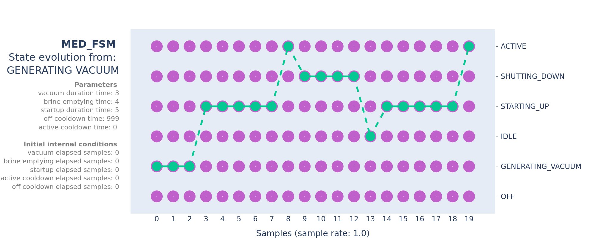

# SolarMED

Modelling and optimal operation of a solar-driven multi-effect distillation system at Plataforma Solar de Almería.

SolarMED contains the models and optimization tools developed to investigate the coordinated operation of a solar thermal field, a thermal energy storage system, and a low-temperature multi-effect distillation (MED) unit. The case study is the experimental installation at Plataforma Solar de Almería (PSA), Spain.

The central problem is the mismatch between the variable availability of solar energy and the operating requirements of a thermal desalination process. Solar irradiance determines the amount and temperature of the heat supplied to the system, while thermal storage makes it possible to transfer part of this energy between operating periods. Consequently, decisions about when to start or stop each subsystem cannot be separated from decisions about flow rates, temperatures, and the use of stored heat. The objective is to increase freshwater production while limiting the electrical energy required to operate the installation.


*Figure 1. Schematic of the SolarMED installation, showing the solar field, heat exchanger, thermal storage, and MED unit. Source: [SolarMED pilot plant](https://github.com/juan11iguel/my-thesis/blob/main/chapters/solarmed-facility.tex).*

## Methodology

### Dynamic modelling

The complete installation is represented by a hybrid dynamic model combining physical and data-driven descriptions of its components. The model includes the solar field, heat exchanger, two-tank thermal storage system, mixing valve, and MED unit. Supervisory finite-state machines describe the operating states of the solar and desalination subsystems, including their start-up, shutdown, and transition constraints.

The component models are calibrated and evaluated against experimental measurements from PSA. Their integration provides a computational representation of the coupled process, accounting for both thermal dynamics and discrete operating decisions. It is intended for simulation, performance evaluation, and optimization over extended operating horizons.

### Operation optimization

The operation problem combines discrete decisions, which determine the operating periods of the subsystems, with continuous decisions, which determine their operating conditions. It is therefore formulated as a mixed-integer nonlinear optimization problem, subject to the thermal and operational constraints of the installation.

A hierarchical strategy separates the problem into three layers:

1. **Operation planning:** candidate start-up and shutdown schedules are evaluated over an optimization horizon, considering the available solar resource and the state of thermal storage.
2. **Operation optimization:** with the operating schedule fixed, a nonlinear optimization problem determines the setpoints of the continuous process variables.
3. **Regulatory control:** lower-level controllers track the resulting setpoints and enforce the required process behaviour.

This decomposition allows decisions with different characteristic time scales to be treated separately, while retaining their influence on cumulative water production and electrical consumption. The operation plan is evaluated before the anticipated start-up and shutdown times, while the operation optimization layer periodically updates the continuous setpoints.


*Figure 2. Evaluation sequence of the operation planning and optimization layers, including the anticipated start-up and shutdown decisions. Source: [Operation optimization](https://github.com/juan11iguel/my-thesis/blob/main/chapters/solarmed-optimization.tex).*

## Example results

### Model validation

The models have been evaluated using experimental tests conducted at PSA. The following examples illustrate their response under variable operating conditions, comparing measurements with model predictions.


*Figure 3. Solar field model calibration and validation. The plots compare irradiance, temperatures, and flow rates over experimental tests. Source: [Hybrid modelling](https://github.com/juan11iguel/my-thesis/blob/main/chapters/solarmed-modelling.tex).*


*Figure 4. MED model validation for two experimental tests, including flow rates, temperatures, and vacuum pressure. Source: [Hybrid modelling](https://github.com/juan11iguel/my-thesis/blob/main/chapters/solarmed-modelling.tex).*

The integrated model reproduces the main thermal and operational responses of the installation over multi-hour prediction horizons. Its accuracy depends on the prediction horizon and on the subsystem considered; the modelling chapter provides the error metrics and a more extensive analysis. Additional validation procedures are available in the [modelling package](modeling/README.md#examples).

### Supervisory state transitions

The MED finite-state machine governs transitions between operating states according to the process conditions and the prescribed start-up and shutdown sequences. The following test illustrates the evolution of these discrete states over successive simulation samples.



*Figure 5. Example evolution of the MED supervisory finite-state machine, showing vacuum generation, start-up, active operation, shutdown, and idle states. Source: [MED FSM test results](modeling/results/MED_FSM_test_state_evolution.png).*

### Operation optimization

The optimization strategy was evaluated in a seven-day system simulation against two alternatives: heuristic rule-based operation and continuous-variable optimization with a fixed operating schedule. The proposed strategy improved the evaluated performance by 32% and 21%, respectively. These results concern the specified simulation and objective formulation; they are not a general performance guarantee. The associated implementation and experimental configurations are documented in the [optimization package](optimization/README.md).

## Repository structure

```text
SolarMED/
├── modeling/              Dynamic models, calibration, validation, and examples
├── optimization/          Operation-planning and optimization implementations
├── .devcontainer/         VS Code development-container configuration
├── Dockerfile.base        Base development image
├── environment.yml        Conda environment and package dependencies
├── SolarMED.code-workspace
└── LICENSE.md
```

The repository is organized into two Python packages:

- [`modeling/`](modeling/README.md) (`solarmed-modeling`) contains the complete `SolarMED` model, individual component models, supervisory finite-state machines, and material for calibration and validation.
- [`optimization/`](optimization/README.md) (`solarmed-optimization`) contains the optimization strategies, scripts, notebooks, and associated documentation.

The package-specific READMEs describe their interfaces, examples, dependencies, and procedures for reproducing individual evaluations.

## Development environment

Python 3.11 is required by both packages. A Conda environment is defined in [`environment.yml`](environment.yml), and a container configuration is provided for development with Docker and Visual Studio Code.

Clone the repository and open it in Visual Studio Code:

```bash
git clone https://github.com/juan11iguel/SolarMED.git
cd SolarMED
code SolarMED.code-workspace
```

With Docker and the Dev Containers extension installed, select **Dev Containers: Reopen in Container** from the command palette. The development environment can then be created from the repository root:

```bash
conda env create -f environment.yml
conda activate conda-env
```

The editable package paths in `environment.yml` refer to `/workspaces/SolarMED/modeling` and `/workspaces/SolarMED/optimization`. When installing outside the development container, these paths must be adapted to the local checkout before creating the environment.

Some MED model implementations use compiled MATLAB components and require a compatible MATLAB Runtime. These dependencies are not included in the base container image. See the [modelling package instructions](modeling/README.md#installation) for the additional setup, and the [optimization package instructions](optimization/README.md#getting-started) for the associated numerical environment and execution procedures.

## Research context and references

The methodology, experimental installation, model validation, and optimization results are described in:

Serrano Rodríguez, J. M., *Towards optimal resource management in solar thermal applications: CSP and desalination*. PhD thesis, University of Almería. [Thesis repository](https://github.com/juan11iguel/my-thesis) · [DOI: 10.5281/zenodo.17885527](https://doi.org/10.5281/zenodo.17885527).

The relevant chapters are available in the thesis source: [thermal desalination and problem context](https://github.com/juan11iguel/my-thesis/blob/main/chapters/solarmed.tex), [system modelling](https://github.com/juan11iguel/my-thesis/blob/main/chapters/solarmed-modelling.tex), and [operation optimization](https://github.com/juan11iguel/my-thesis/blob/main/chapters/solarmed-optimization.tex).

A complementary study on resource management in solar thermal applications, focused on combined cooling in concentrated solar power plants, is available in [SOLhycool](https://github.com/juan11iguel/SOLhycool).

## License

Copyright 2025 Juan Miguel Serrano. The source code is distributed under the Apache License, Version 2.0. See [`LICENSE.md`](LICENSE.md).
